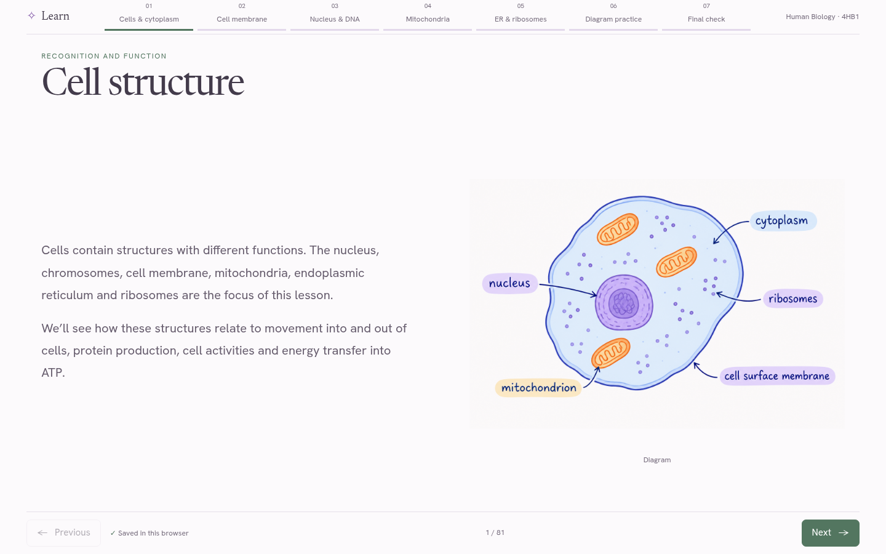

# Cell Structure · Learn

A fresh, full-viewport learning module built directly from the current academic handoff. It contains **53 teaching units**, integrated automatically marked checkpoints, feedback, targeted review and results. Responsive continuation pages keep the complete content readable on phones and with enlarged text, without page or panel scrolling.

[Phone](docs/phone.png) · [Connected map](docs/mindmap.png) · [Matching](docs/matching.png) · [Phone matching](docs/matching-phone.png)

## Open the complete module

Open [`dist/index.html`](dist/index.html) in a modern browser. This single HTML embeds all teaching, questions, styles, JavaScript, original diagrams and fonts. It runs offline without a login, backend or external runtime dependencies.

Alternatively, run `npm run dev` and visit `http://localhost:4173`. Progress is saved in the current browser. Storage for local files varies by browser; a stable hosted origin provides consistent persistence. No student data leaves the module.

[Published private preview](https://cell-structure-learn-nlsigai26.prettyray24.chatgpt.site/)

## Current academic authority

The original updated ZIP and unchanged HTML are preserved in [`resources/current-input/`](resources/current-input/). Part A supplies the build requirements; Part B supplies the entire academic boundary. The new lesson, questions and eligibility decisions were designed independently from this handoff.

[`resources/source-inventory.json`](resources/source-inventory.json) records 70 original content, table, image and image-annotation items. [`resources/coverage-and-eligibility.json`](resources/coverage-and-eligibility.json) maps every item to teaching units and records the assessment decisions. These are builder records and are not embedded as a separate reference mode.

All supplied academic details appear in the ordinary Previous/Next teaching sequence, including histones, introductory context, cross-references and printed image annotations. Introductory material is taught without becoming a checkpoint target merely because it is present. The updated pack includes smooth ER and cisternae; their supplied details are taught, with no checkpoint targeting those introductory details.

The application uses only the two unchanged supplied diagrams and their printed labels/pointers. Reversible rectangles mask unrelated labels; quiz target labels are covered before an attempt and restored in feedback. No new anatomical drawings or replacement labels are added. These images are schematics: real-micrograph identification and direct identification of an individual chromosome are explicitly reported as unassessed.

There is no separate reference mode, transcript, appendix, image gallery, written self-check or unrestricted text response.

## Learning and assessment

- Persistent Previous/Next controls, position, keyboard navigation and boundary states.
- A quiet horizontal section outline becomes prominent on hover/focus; a Sections button provides touch access.
- Key terms have restrained emphasis; function clauses have an underline reveal with a static reduced-motion equivalent.
- Connected relationship maps show the supplied links among cell structures and functions.
- All MCQs have four or more options and one answer key. Small matching exercises use radio circles.
- Matching with five choices uses drag-and-drop, with mouse/touch dragging and keyboard/tap select-and-place. Answers can be moved, swapped, cleared or returned. Every term must be filled before the set is checked.
- Feedback requires an attempt. Wrong answers allow review, retry and onward navigation.
- **14 practice points and 11 final points** are available. Results use actual attempted counts, separate first attempts from retry corrections, and distinguish function, structure and schematic identification.
- Practice again clears practice answers only. Restart requires confirmation and clears this version's progress.

The bank changed completely, so this version uses a new browser-storage namespace (`cell-structure-dea7daf1-fresh`). Older lesson grades are not treated as attempts on new questions.

## Source and build

| Path | Purpose |
| --- | --- |
| `src/lesson.json` | Fresh teaching, question bank, supported source mappings |
| `src/player.js` | Presentation, adaptive continuations, masking, matching, grading and storage |
| `src/media.json` | Original-image crops and reversible label-mask coordinates |
| `src/styles.css` | Full-screen layouts, typography, focus and reduced-motion styles |
| `src/index.html` | Single-file shell and accessible dialogs |
| `scripts/inventory.py` | Inventory of original Part B and inspected image annotations |
| `scripts/compose.py` | Reproducible lesson and coverage composition |
| `assets/` | Original diagrams, local fonts and licences |
| `resources/` | Original input, builder inventory, coverage and implementation validation |
| `build.py` | Standard-library Python single-file builder |
| `tests/` | Content, full learning flow, matching and responsive-layout checks |

Run `python3 scripts/inventory.py`, `python3 scripts/compose.py`, then `npm run build` to regenerate the lesson from its composition script. When editing lesson content, update the composition script so future regeneration retains the change. Commit the rebuilt `dist/index.html` with source changes.

Newsreader and Hanken Grotesk are bundled under their SIL Open Font Licences. Hanken Grotesk supplies the sans-serif face used for the requested “Hansen Grotesk” styling.

## Validation

Install test dependencies with `npm install` and Chromium with `npx playwright install chromium`. Serve `dist/` on port 4173, then run `npm test`. Optional environment variables `PLAYWRIGHT_MODULE`, `CHROMIUM_PATH` and `TEST_URL` select existing installations or another test origin.

Tests verify unchanged original files, complete inventory mapping, outcome eligibility, source-text preservation through pagination, the complete learning journey, radio/matching interactions, mouse/touch/keyboard controls, score denominators, retries and persistence, review returns, resets, diagram-label hiding/restoration, outline clearance, offline assets, and responsive layouts including 150–200% text and desktop-zoom-equivalent viewport sizes. Reports are saved in `resources/*-validation.json`.

## Integration and publishing

Serve `dist/` from any static host, or put the HTML in a viewport-sized iframe. For direct source integration, scope the global presentation styles to the host application. The application deliberately needs the full available viewport.

`.openai/hosting.json` retains the existing private Sites project. GitHub and Sites receive the same committed source state, and the deployment archive is created from that commit. Original older inputs remain preserved separately in Git history and the repository's original source archive.

Rights to the supplied academic text and illustrations remain with their respective owners.
